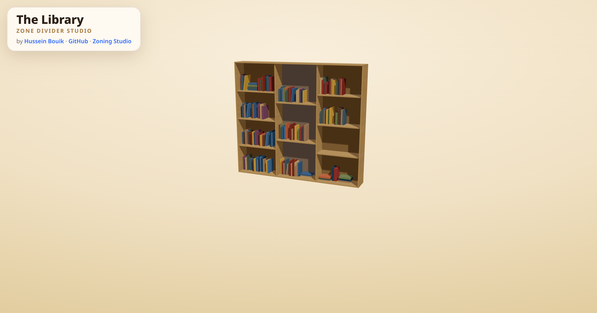

# The Library — Zone Divider Studio

An interactive 3D bookcase configurator: divide a bookcase wall into bays,
drag the dividers, add or remove shelves bay by bay — and apply true
**linear division** in both directions, in one action.

**Live demo:** https://husseinbouik.github.io/library-studio/



## Powered by the linear-zone-divider engine

Every millimetre in this demo is computed live by Hussein Bouik's own
**linear-zone-divider** engine — the same engine behind
[Zoning Studio](https://github.com/husseinbouik/zoning-studio)
([live demo](https://husseinbouik.github.io/zoning-studio/)). The engine
source is vendored verbatim in [`src/engine/`](src/engine/) and is never
modified here; this app only adapts its 1D output (clear openings in
millimetres, panel thickness accounted) into a bookcase:

- **Width → bays.** The engine divides the bookcase's clear interior
  width by a ratio formula — one section per bay. Bay weights are stored
  as the bays' clear widths in mm, so feeding them back as ratio sections
  makes the engine reproduce them exactly; that is what makes divider
  dragging precise.
- **Height → shelf rows.** Each bay runs the engine again on the clear
  interior height with an equal formula to place its shelves.
- **Linear division** (the named feature in the UI) is the engine doing
  what it is named for: an equal-ratio formula applied in one action —
  across the whole width, across one bay's width, or down one bay's
  height, into 2–6 equal zones.

The engine is mid-refactor upstream, so this app deliberately uses only
the division paths that are verified: plain positive ratio formulas.
That usage is locked in by tests (`src/lib/design.test.ts`) which
reproduce, input for input, the outputs Zoning Studio asserts for the
same engine, and check every editing operation's invariants.

## What you can do

- **Orbit** — drag to orbit, scroll or pinch to zoom.
- **Drag a divider** — grab any vertical divider (it turns blue, with a
  handle) and slide it; the two neighbouring bays re-weight through the
  engine, respecting a 24 cm minimum bay width. Live widths show as you
  drag, and in the bay chips below the bookcase.
- **Classical editing** — add/remove bays, split a bay in two, merge a
  bay with its neighbour, and add/remove shelves per bay (tap a bay in
  3D, or its chip, to select it).
- **Linear division** — divide the whole width, one bay's width, or one
  bay's height into 2–6 equal zones in a single action.
- **Resize & refinish** — total width 180–360 cm; oak, walnut or white
  finish. Panels and dividers are 18 mm throughout.

Books are procedural (seeded, so a bay's books never reshuffle) — one
zone is always left empty so the division itself stays visible.

## Tech

Vite · React 18 · TypeScript · React Three Fiber / drei · three.js ·
the vendored linear-zone-divider engine (TypeScript). No image assets:
the wood is a procedural canvas texture, the books are instanced boxes,
and the lighting is plain scene lights (no remote HDR/textures).

## Develop

```bash
npm install
npm run dev     # local dev server
npm test        # engine + model tests (jest)
npm run build   # static build into dist/ (deployed to GitHub Pages)
```

## Author

Hussein Bouik — [LinkedIn](https://www.linkedin.com/in/hussein-bouik) ·
[Zoning Studio](https://husseinbouik.github.io/zoning-studio/) ·
[Article Models](https://husseinbouik.github.io/articles-models/)
